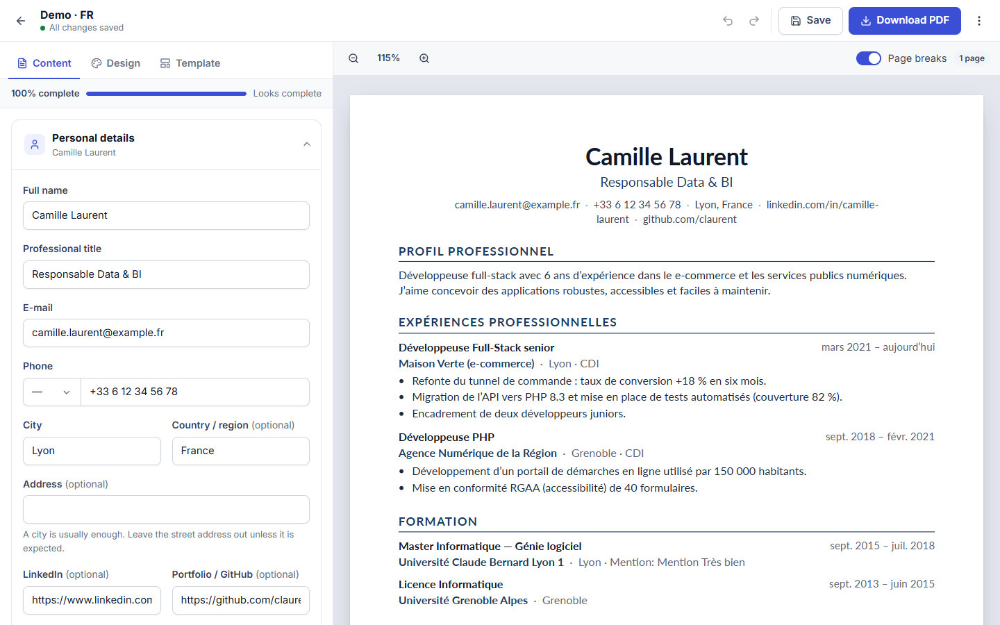
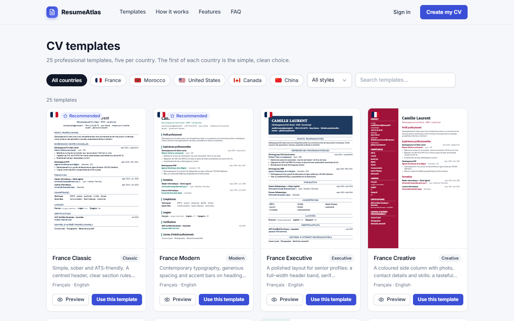
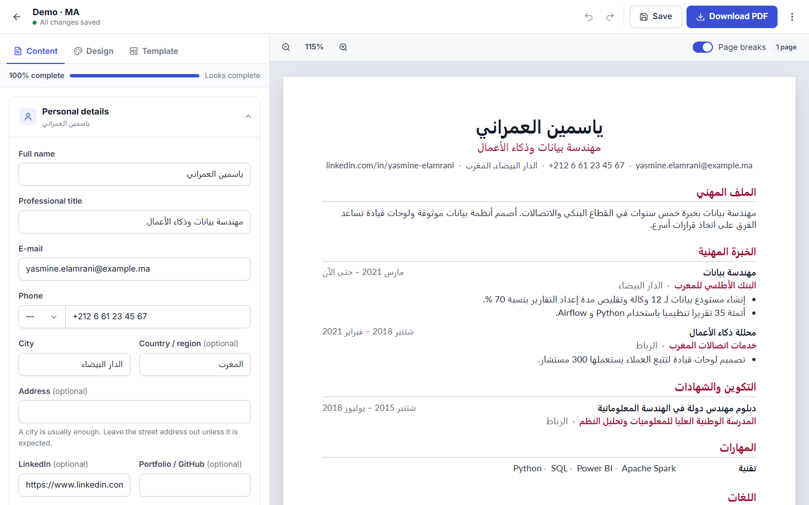
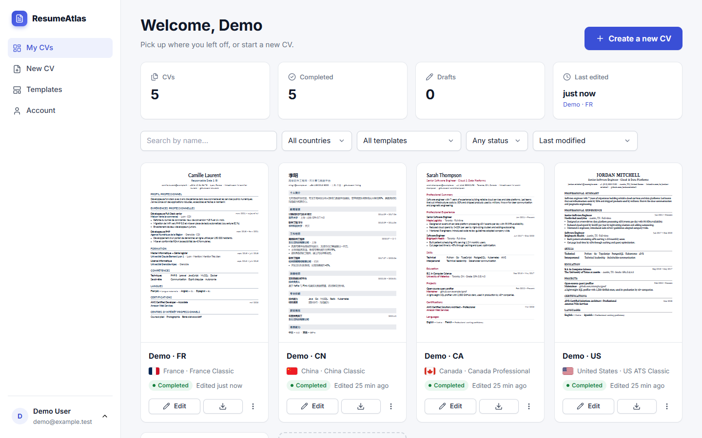
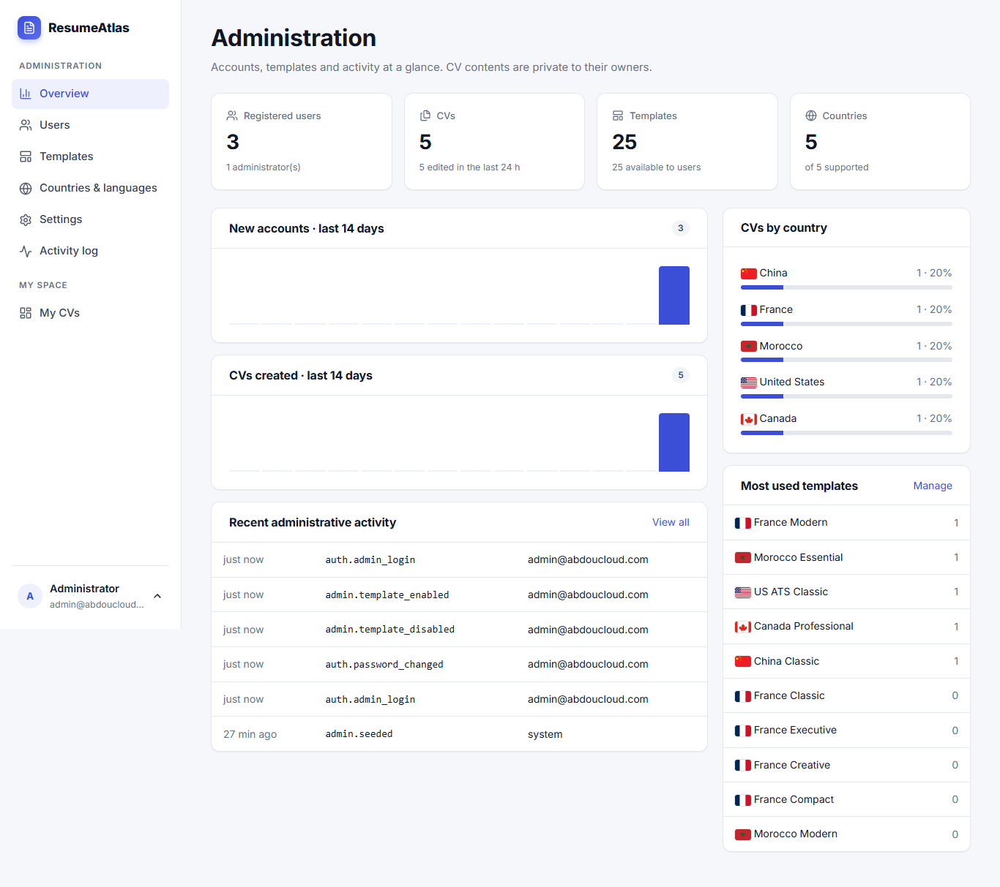

# ResumeAtlas — multi-country CV builder

ResumeAtlas is a web application for writing a professional CV (résumé) and downloading it as a
real A4 PDF. Each CV follows the conventions of one of five countries — **France, Morocco, the
United States, Canada and China** — with five distinct templates per country (25 in total), in
French, English, Arabic (right-to-left) or Simplified Chinese.



| | |
|---|---|
|  |  |
|  |  |

## Features

- **Accounts** — registration, sign-in, sign-out, password reset by e-mail (when mail is
  configured), password change, account deletion. Sign-in is throttled; a password change ends the
  other sessions.
- **CV library** — create, rename, duplicate, delete, download; search, filter by country, status
  and template; sort.
- **Creation wizard** — country and language first, then a template with live thumbnails.
- **Editor** — form on the left, live A4 preview on the right.
  - Debounced autosave with conflict detection (two tabs never overwrite each other silently) and a
    local backup when the network or session fails.
  - Undo/redo (Ctrl+Z / Ctrl+Y), Ctrl+S, zoom, page-break guides and an exact page count
    from the PDF engine.
  - Every section can be added, removed, renamed, hidden and reordered (drag and drop, or the
    up/down buttons from the keyboard); entries and bullet points too.
  - Photo upload (validated, re-encoded, stored outside the web root, served only to its owner).
  - Switch template, country or language at any time without losing content.
  - Design panel: accent colour (contrast-checked), font, text size, line spacing, margins,
    section spacing, date format, header or sidebar variant, length target.
- **Country conventions** in configuration (`config/countries.php`): section order, date
  formats, phone format, photo guidance, optional personal details, tips and length hints.
- **PDF** — server-side with mPDF: strict A4, automatic extra pages, embedded fonts, Arabic shaping
  and right-to-left layout, Chinese glyphs, meaningful file names
  (`Camille_Laurent_CV_France.pdf`), downloads only for the owner.
- **Administration** — overview statistics; users: search and filter, create an account (with a
  temporary password shown once), edit name and e-mail, reset a password (signs the user out),
  activate/deactivate, grant or remove admin rights, delete an account with its CVs; templates (availability, name, description, category, languages,
  recommended flag, order), countries and languages, application settings, and an activity log.
- **Accessible and responsive** — keyboard navigation, labelled controls, visible focus,
  `prefers-reduced-motion`, and phone layouts including an Edit/Preview switch in the editor.

## Technology

PHP 8.2+ (no framework; a small modular core under `app/Core`), MySQL 8+ through PDO prepared
statements, plain HTML/CSS/JavaScript, Composer, [mPDF](https://mpdf.github.io/) for PDFs and
PHPMailer for e-mail. There is no build step and no Node.js runtime.

mPDF was chosen over Dompdf because Dompdf cannot shape Arabic text or lay out right-to-left
paragraphs, and needs extra work for CJK fonts.

## Requirements

- PHP 8.2 or newer with the `pdo_mysql`, `mbstring`, `gd`, `fileinfo` and `json` extensions
  (plus `curl` to run the HTTP tests)
- MySQL 8 (MariaDB 10.4+ works for development)
- Composer 2
- Apache with `mod_rewrite`, Nginx, or PHP's built-in server for development

## Installation

```bash
git clone https://github.com/AbdoHerO/generationResumeMultiCountry_Models.git
cd generationResumeMultiCountry_Models
composer install            # add --no-dev in production
cp .env.example .env
php bin/console key:generate   # paste the printed APP_KEY line into .env
```

Edit `.env`: database credentials, `APP_URL`, `APP_ENV=production` and `APP_DEBUG=false` on a
server, and the administrator settings (see below). Create the database, for example:

```sql
CREATE DATABASE cvbuilder CHARACTER SET utf8mb4 COLLATE utf8mb4_unicode_ci;
```

The schema is created automatically on the first request (`AUTO_MIGRATE=true`, protected by a
database lock). To run it by hand instead:

```bash
php bin/console migrate   # tables + idempotent seeders (templates, settings, administrator)
php bin/console status
```

### Development server

```bash
php -S 127.0.0.1:8000 -t public public/index.php
php bin/console seed:demo   # optional: demo@example.test / demo-password-1 with 5 sample CVs (refused in production)
```

### Apache / XAMPP

Point the virtual host's document root at `public/` (recommended). `public/.htaccess` routes
every request to `public/index.php` and refuses direct access to other PHP files. If the
document root must be the project folder, the root `.htaccess` forwards requests to `public/`.
`storage/` must be writable by the web server user and must never be served.

### Nginx

```nginx
root /path/to/app/public;
index index.php;
location / { try_files $uri /index.php?$query_string; }
location ~ \.php$ { include fastcgi_params; fastcgi_pass unix:/run/php/php8.3-fpm.sock;
                    fastcgi_param SCRIPT_FILENAME $document_root/index.php; }
```

## Administrator account

An administrator is seeded once, idempotently, by `database/seeders/AdminSeeder.php`:

- e-mail: `ADMIN_EMAIL` (default `admin@abdoucloud.com`)
- initial password: `ADMIN_INITIAL_PASSWORD`, or **`123456789` when it is left empty** (this
  default was requested for the project)

The password is stored only as a `password_hash()` (bcrypt) hash, never in plain text or logs. The
account is flagged `must_change_password`: after the first sign-in the administrator can do
nothing until they choose a new password, and the initial password cannot be kept.

> **Security note.** This repository is public, so the default initial password is public too.
> On any server reachable from the Internet, either set a strong `ADMIN_INITIAL_PASSWORD` in `.env`
> before the first request, or sign in and change the password immediately after deployment.
> A forgotten administrator password can be reset from the server with
> `php bin/console admin:reset-password admin@abdoucloud.com` (prints a one-time temporary
> password that must be changed at the next sign-in).

## Fonts, Arabic and Chinese

- Latin fonts (Lato, Fira Sans, PT Sans, PT Serif, IBM Plex Serif, IBM Plex Mono) ship in
  `public/assets/fonts` under the SIL Open Font License. The same files are used by the browser
  preview (`@font-face`) and by mPDF, so the preview and the PDF match closely.
- Arabic uses mPDF's bundled XB Riyaz font, with automatic script detection, shaping and
  right-to-left layout. E-mails, phone numbers and links stay left-to-right inside Arabic text.
- Simplified Chinese uses mPDF's bundled Sun-ExtA font.
- mPDF's font cache lives in `storage/cache/mpdf` (created on demand).

## E-mail

Password-reset e-mails need `MAIL_MAILER=smtp` and the `MAIL_*` settings. With `MAIL_MAILER=log`
the message is written to `storage/logs` (development); with `disabled` (or no configuration) the
"forgot password" page explains that resets are handled by the administrator.

## Commands

| Command | Purpose |
|---|---|
| `php bin/console migrate` | Apply migrations and run the idempotent seeders |
| `php bin/console seed` | Seeders only (templates, settings, administrator) |
| `php bin/console seed:demo` | Demo user and CVs (development only) |
| `php bin/console key:generate` | Print a new `APP_KEY` |
| `php bin/console admin:reset-password <email>` | Temporary password for an administrator |
| `php bin/console status` | Database, migrations and counts |

## Tests

```bash
vendor/bin/phpunit                    # all suites
vendor/bin/phpunit --testsuite Unit   # Unit | Pdf | Http
```

The suites use a separate database, `cvbuilder_test`, which is created and migrated
automatically with the connection settings from `.env`. The HTTP suite starts PHP's built-in
server on port 8765 (`TEST_HTTP_PORT` changes it). An optional browser check of the editor is in
`tests/browser/` (Chrome + puppeteer-core; not part of the application). Results and what is not
covered: [docs/TEST-REPORT.md](docs/TEST-REPORT.md).

## Project layout

```
app/Core          framework: router, request/response, sessions, views, database, migrations, errors
app/Controllers   pages, JSON API (Api/), administration (Admin/)
app/Middleware    auth, guest, admin, CSRF, forced password change
app/Models        database access (prepared statements only)
app/Services      auth, countries, labels, mail, photos; Cv/ = schema, renderer, PDF, design
app/Views         PHP templates (escaped with e())
config            app, countries, CV languages (cv/*.php), templates, design options, icons
database          SQL migrations and seeders
public            front controller and assets (CSS, JS, fonts, images)
routes/web.php    all routes and their middleware
storage           logs, cache, uploaded photos (private, not in git)
tests             PHPUnit suites, optional browser check
docs              architecture, deployment, test report, screenshots
```

More detail: [docs/ARCHITECTURE.md](docs/ARCHITECTURE.md) ·
[docs/DEPLOYMENT.md](docs/DEPLOYMENT.md).

## Known limitations

- The live preview is HTML rendered in the browser; the PDF is rendered by mPDF from the same
  markup and fonts. They match closely but not pixel for pixel. Page breaks shown in the preview
  are estimates; the page count badge switches to the exact PDF count a few seconds after edits.
- User text is not translated when the CV language changes; only headings, dates and labels are.
- Only one photo per CV; no cropping tool (photos are centre-cropped to a square).
- No public CV sharing links, cover letters or DOCX export.
- Password-reset e-mails need SMTP settings; without them, resets go through an administrator.
- Rate limits are per IP address and e-mail; behind a proxy, set `TRUSTED_PROXIES` so the real
  client address is used.

## Licences

Application code: all rights reserved by the repository owner unless a licence is added.
Fonts: SIL Open Font License 1.1 (`public/assets/fonts/*.txt`). Icons: Lucide, ISC
(`public/assets/icons/LUCIDE-LICENSE.txt`). mPDF: GPL-2.0-only; PHPMailer: LGPL-2.1.
